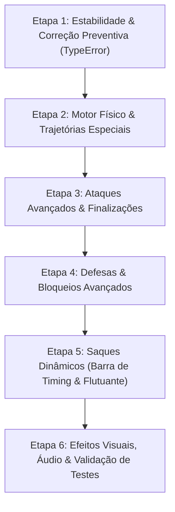

# Plano Modular de Engenharia de Gameplay & Lances Especiais — Vôlei Arcade Flame/Flutter

**Autor:** Senior Game Designer & Gameplay Engineer (Flutter & Flame)  
**Documento de Origem:** `lib/.specs/VOLLEYBALL_SPEC.md` (v2.0.0)  
**Status:** Proposta Completa para Validação / Aguardando Aprovação  
**Versão:** 2.0.0  

---

## 1. Visão Geral da Arquitetura & Diretrizes de Execução

Este plano detalha a implementação incremental e modular dos novos lances essenciais e mecânicas de gameplay para o Vôlei Arcade, mantendo a estabilidade retro arcade, zero regressões em testes e 60 FPS estáveis na Web.

### Princípios de Engenharia Adotados:
1. **Desenvolvimento Orientado a Especificação (Spec-Driven):** Cada lance segue rigorosamente a física, o timing e o game feel descritos na spec.
2. **Modularidade e Baixo Acoplamento:** As regras de física de trajetórias residem em `BallPhysicsEngine`, os cálculos de contato e timings em `TimingEvaluator`, e o estado visual e temporizações em controladores dedicados.
3. **Execução Incremental:** Implementação em 6 etapas isoladas e testadas individualmente, garantindo que o jogo permaneça jogável e compilável a cada passo.
4. **Resolução Preventiva de Falhas:** Blindagem total contra exceções nulas (*TypeError: null is not a subtype of type String*).

---

## 2. Divisão Modular em 6 Etapas

---

### ETAPA 1: Estabilidade & Correção Preventiva (TypeError)
**Objetivo:** Identificar, auditar e blindar preventivamente todos os pontos de injeção de String no HUD, nos popups de timing, no mapeamento de Web Audio e nos widgets de bandeira, eliminando definitivamente exceções do tipo `TypeError: null: type 'Null' is not a subtype of type 'String'`.

* **1.1. Blindagem de Widgets de HUD e Placar (`lib/main.dart`):**
  - Proteger referências a `teams[0].name` e `teams[1].name` com `?? 'TIME'`.
  - Garantir que nomes de equipes criados no modo Versus (`TeamInfo('P1: ${t1.name}')`) nunca recebam valores nulos.
  - Assegurar que `_msgText` e mensagens temporárias nunca recebam strings nulas.
* **1.2. Blindagem de Bandeiras e Seleção de Países (`lib/rendering/flag_renderer.dart`):**
  - Alterar assinatura de `flagWidget(String? countryName)` e `drawFlag(..., {required String? countryName})` para aceitar tipos anuláveis e aplicar fallback defensivo:
    `final name = (countryName != null && countryName.trim().isNotEmpty) ? countryName : 'BRASIL';`
* **1.3. Blindagem de Timing Popups (`lib/effects/timing_popup.dart`):**
  - Garantir que `TimingPopupItem.text` receba validação: se `text` for nulo ou vazio, usar fallback `'BOM'`.
* **1.4. Blindagem do Sistema de Áudio (`lib/audio/arcade_audio_web.dart` & `arcade_audio_stub.dart`):**
  - Adicionar indexação segura e clamp em `trackNames`:
    `trackNames[(_currentTrack % trackNames.length).abs()]`
  - Tratar chamadas de interop JS com retorno nulo ou undefined.
* **Critério de Validação da Etapa 1:** Compilação limpa, zero erros de runtime no console do navegador e testes existentes 100% passando.

---

### ETAPA 2: Motor Físico Avançado & Trajetórias Especiais
**Objetivo:** Expandir `BallPhysicsEngine` com suporte a dinâmicas aerodinâmicas avançadas requeridas pelos novos lances (trajetória senoidal turbulenta do saque flutuante e amortecimento com desaceleração brusca de largadinha).

* **2.1. Trajetória de Saque Flutuante (Oscilação Harmônica sem Topspin):**
  - Adicionar parâmetros de turbulência em `BallPhysicsState`: `double floatWaveTime`, `double floatAmpY`, `double floatAmpZ`.
  - Em `BallPhysicsEngine.step`, quando `ball.isFloating` estiver ativo:
    $$vy_{\text{flut}} = A_y \cdot \sin(18.0 \cdot t + \phi) \cdot e^{-0.15 t}$$
    $$vz_{\text{flut}} = A_z \cdot \cos(24.0 \cdot t + \phi) \cdot e^{-0.15 t}$$
  - A bola viaja sem girar (`angle` congelado), oscilando suavemente e caindo de forma não linear antes do solo.
* **2.2. Lançamento de Largadinha Amortecida (`BallPhysicsEngine.launchTip`):**
  - Criar método específico de largadinha:
    - Desaceleração de 65% na velocidade horizontal ($vx \times 0.38$, $vy \times 0.38$).
    - Impulso vertical controlado ($vz \approx 85\text{px/s}$) que passa a rede com folga de $20\text{px}$ e desce suavemente na zona morta (entre $50\text{px}$ e $110\text{px}$ da fita).
    - Topspin zerado.
* **2.3. Atualização do Algoritmo de Predição (`BallPhysicsEngine.predict`):**
  - Garantir que o integrador de predição contemple as perturbações do saque flutuante e da largadinha para a IA reagir realisticamente.
* **Critério de Validação da Etapa 2:** Testes unitários para `launchTip`, oscilação de `isFloating` e estabilidade de integração numérica.

---

### ETAPA 3: Ataques Avançados & Finalizações
**Objetivo:** Implementar os 4 lances ofensivos essenciais no ciclo de rali e nos controles dos jogadores.

* **3.1. Super Cortada Cravada (Monster Spike):**
  - Gatilho: Ápice do salto (`relativeZ` entre 60 e 125, $|playerVz| \le 160$, `dist2D <= 80px`) + analógico ofensivo (`aimX > 0.25`).
  - Efeito: Dispara `BallPhysicsEngine.launchFast` com multiplicador $1.38\times$, topspin $+28.0$, hitstop de $60\text{ms}$, trauma de screen shake $0.70$ e popup dourado `"CORTADA PERFEITA!"`.
* **3.2. Largadinha Tática (The Tip / Feint):**
  - Gatilho: No ar próximo à rede, analógico neutro ou puxado para trás (`aimX < 0.15`) ao pressionar o botão de bater (ou segundo toque com intenção de largada).
  - Ação: Dispara `BallPhysicsEngine.launchTip(ball, dirOpp)`.
  - Feedback: Som sutil de ponta dos dedos, popup ciano/lilás `"LARGADINHA!"` e bloqueio rival salta em vão.
* **3.3. Ataque Rápido de Meio (Quick Attack / Tempo 1):**
  - Gatilho: O jogador central (slot 1) inicia corrida e salto antecipado rente à rede antes do levantamento.
  - Ação: O levantador despacha um passe rápido e rasante ($apexZ \approx 165\text{px}$ em vez de $240\text{px}$). O atacante golpeia na subida da bola, encurtando o tempo de reação adversário para $0.20\text{s}$.
  - Feedback: Popup `"ATAQUE RÁPIDO!"` e rastro azul-ciano.
* **3.4. Ataque do Fundo (Pipe Attack / Linha dos 3 Metros):**
  - Gatilho: Jogador de trás (slot 0) recebe bola levantada no centro e salta de trás da linha dos 3 metros ($x < 300\text{px}$ ou $x > 600\text{px}$).
  - Ação: Salto com impulso horizontal estendido ($vx_{\text{impulse}} \approx 340\text{px/s}$), sobrevoando a linha no ar e cravando a bola no terço final da quadra oposta.
  - Feedback: Marca de poeira na decolagem dos 3m e popup `"PIPE ATTACK!"`.
* **Critério de Validação da Etapa 3:** Testes automatizados cobrindo cada um dos 4 tipos de ataque com verificação de trajetórias, velocidades e ratings.

---

### ETAPA 4: Defesas & Bloqueios Avançados
**Objetivo:** Implementar os lances defensivos de alto nível para ralis emocionantes.

* **4.1. Peixinho Defensivo (Pancake / Dive Save):**
  - Gatilho: Bola rápida prestes a quicar no chão ($10\text{px} \le bz \le 35\text{px}$, tempo até queda $< 0.16\text{s}$) e defensor em distância de mergulho ($65\text{px} \le dist2D \le 145\text{px}$).
  - Ação: O atleta mergulha em slide rente ao piso (`p.diveTimer = 0.45s`, deslizando na quadra), estica a mão espalmada sob a bola e a rebate para cima em parábola vertical de recuperação ($vz = 380\text{px/s}$).
  - Feedback: Micro-slowdown dinâmico ($dt \times 0.35$ por $120\text{ms}$), partículas de poeira deslizando pelo piso, popup dourado `"PEIXINHO DEFENSIVO!"`.
* **4.2. Bloqueio Toco (Monster Block / Roof):**
  - Gatilho: Salto de bloqueio na rede sincronizado com a cortada rival a menos de $35\text{px}$ da fita, com suporte a bloqueio duplo se o companheiro estiver junto.
  - Ação: A bola é rebatida diretamente para o solo da quadra atacante ($bvx = dirOpp \times 560\text{px/s}$, $bvz = -220\text{px/s}$).
  - Feedback: Hitstop de $60\text{ms}$, tremor horizontal de câmera, som pesado de abafamento e popup `"SUPER BLOQUEIO TOCO!"`.
* **4.3. Recuperação Fora da Quadra:**
  - Gatilho: Bolas desviadas no bloqueio que voam além das linhas laterais ou de fundo da quadra.
  - Ação: Jogador tem raio de locomoção liberado na área de escape externa (até $120\text{px}$ fora da quadra), corre em velocidade ampliada ($1.25\times$) e desfere manchete invertida em arco alto devolvendo a bola para a quadra amiga.
  - Feedback: Aplauso imediato da torcida e popup `"RECUPERAÇÃO ESPETACULAR!"`.
* **Critério de Validação da Etapa 4:** Testes de física para pancake save no último frame, colisão de teto de bloqueio e resgate externo.

---

### ETAPA 5: Saques Dinâmicos (Barra de Timing & Flutuante)
**Objetivo:** Oferecer variedade tática e controle refinado na fase de saque.

* **5.1. Saque Viagem Potente com Mini-Barra Visual de Timing:**
  - Jogador saca lançando a bola para cima e salta.
  - Mini-barra de timing curva/horizontal renderizada acima do jogador:
    - Indicador em tempo real percorrendo a barra durante o salto.
    - Zona central dourada (Perfeito): saque com $1.35\times$ de velocidade, topspin agressivo e grande chance de quebrar a recepção ou marcar Ace.
    - Zona intermediária ciano (Bom): saque com $1.15\times$ de velocidade.
    - Zona de borda (Cedo/Tarde): saque lento ou com risco de rede.
* **5.2. Saque Flutuante com Oscilação Senoidal Imprevisível:**
  - Executado sem corrida de viagem com toque seco no centro da bola.
  - Ativa o modo `ball.isFloating = true` com topspin 0 e perturbação senoidal no ar.
  - A bola não gira visualmente e oscila lateralmente, gerando incerteza de recepção.
  - Popup `"SAQUE FLUTUANTE!"`.
* **Critério de Validação da Etapa 5:** Testes com avaliação de saque viagem e trajetória senoidal do flutuante.

---

### ETAPA 6: Efeitos Visuais (Juice), Áudio & Validação de Testes
**Objetivo:** Consolidar todos os novos feedbacks audiovisuais, estender a suíte de testes de jogabilidade e validar a compilação Web.

* **6.1. Efeitos Visuais & Partículas:**
  - Rastro contínuo com partículas para o Monster Spike e o Saque Viagem Perfeito.
  - Efeito de rastro de poeira no solo para o mergulho de Peixinho.
  - Brilho de choque na fita da rede para o Bloqueio Toco.
* **6.2. Efeitos Sonoros Retrô no `ArcadeAudio`:**
  - Síntese de áudio para o estalo do Monster Spike, o amortecimento da Largadinha, o impacto do Peixinho e a buzina de Ace.
* **6.3. Bateria Completa de Testes Automatizados:**
  - Expandir `test/gameplay_physics_test.dart` com testes dedicados para cada um dos 9 novos lances.
  - Garantir 100% de aprovação em todos os testes (`flutter test`).
  - Executar compilação completa para Web (`flutter build web --release`).
* **Critério de Validação da Etapa 6:** Relatório de testes com 100% dos cenários validados e build web gerado sem erros.

---

## 3. Matriz de Ativação dos Lances e Parâmetros Físicos

| Lance | Posição / Contexto | Comando / Gatilho | Velocidade ($v$) | Topspin ($\omega$) | Hitstop / Efeito |
| :--- | :--- | :--- | :--- | :--- | :--- |
| **Super Cortada Cravada** | Ápice salto na rede | Bater + analógico frente/baixo | $1.38\times$ ($tt \approx 0.28\text{s}$) | $+28.0$ a $+32.0$ | Hitstop $60\text{ms}$ + Shake $0.70$ + Rastro Dourado |
| **Largadinha Tática** | No ar na rede | Toque suave + analógico neutro/trás | $0.38\times$ ($tt \approx 0.45\text{s}$) | $0.0$ | Queda curta atrás do bloqueio ($50\text{px}$ a $110\text{px}$) |
| **Ataque Rápido Meio** | Tempo 1 / Fita | Levantamento rasante + atacante subindo | $1.25\times$ ($tt \approx 0.20\text{s}$) | $+20.0$ | Parábola baixa ($apexZ \approx 165$), surpresa na defesa |
| **Pipe Attack (3m)** | Trás dos 3 metros | Salto horizontal longo no meio | $1.30\times$ ($tt \approx 0.32\text{s}$) | $+24.0$ | Impulso horizontal longo, poeira na linha dos 3m |
| **Peixinho Defensivo** | Rente ao chão ($bz < 35$) | Botão defesa + direção bola | Deslize $440\text{px/s}$ | Bola sobe $vz = 380$ | Micro-slowdown $120\text{ms}$ + Poeira no solo |
| **Bloqueio Toco** | Fita na rede | Salto rente no frame do corte | Devolve $bvx = 560$ | $bvz = -220$ | Hitstop $60\text{ms}$ + Flash na rede + Devolução direta |
| **Recuperação Fora** | Bola fora das 4 linhas | Corrida para além dos limites | Sprint $1.25\times$ | Arco alto ($apexZ = 260$) | Manchete invertida devolvendo para a quadra |
| **Saque Viagem** | Fundo da quadra | Lançar + correr + saltar + barra timing | $1.35\times$ (Perfeito) | $+30.0$ | Mini-barra de timing sobre a cabeça + Rastro potente |
| **Saque Flutuante** | Fundo da quadra | Toque seco sem salto / salto leve | $1.05\times$ | $0.0$ (Sem giro) | Oscilação senoidal no ar ($A_y \approx 14$, $A_z \approx 10$) |

---

## 4. Próximos Passos e Aguardo de Validação

> [!IMPORTANT]
> **Status:** O arquivo `.specs/VOLLEYBALL_SPEC.md` foi atualizado com a especificação técnica completa de cada mecânica. Este arquivo `PLANO.md` descreve a arquitetura modular e as 6 etapas de execução.
> **Conforme suas diretrizes, nenhum código foi alterado antes da sua aprovação.**  
> Por favor, avalie as etapas propostas. Assim que você der o aval, iniciaremos a execução da **Etapa 1**!
